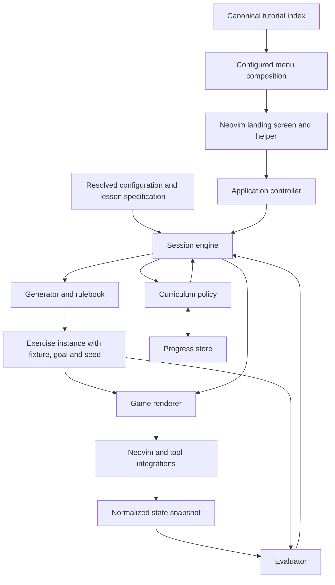

# Proposed architecture

Status: design proposal, 2026-10-23. This describes the target architecture, not the
complete current API or directory tree. Milestone 1 now implements the catalog,
providers, configurable menu/controller/renderer, defaults, and storage path roots;
[content contracts](content.md) documents their shipped API. [Roadmap](roadmap.md) owns product goals and priorities;
[adapter contract](adapters.md) describes the implemented API. Installation instructions
for the current checkout are in [usage](usage.md#installation).

The current UI supports two actual layouts: responsive floating games/menus and a
native full-tab Typing workspace with normal splits. File practice keeps ordinary
editing, saving, and window/tab commands available, and retains learner documents
when leaving practice. Commands and buffer-local LocalLeader/Plug mappings provide
application actions; do not repurpose native editing keys. The public Menu action
is separate from quit. See [current controls and Typing](usage.md#commands-and-controls).

## Platform and scope

Build a single-user **Neovim plugin** with a configurable landing screen. Typing,
Terminal, Terminal IDE, and Programming are bundled menu defaults, not four fixed
branches in application code. No Vim host, account management, user profiles, or
standalone runtime is required. Pure Lua domain logic remains useful for testing.

The prototype API is not a compatibility constraint. Replace contracts when the
vision requires it; keep [current usage](usage.md) accurate until changes land.
Choose and test an explicit minimum Neovim version before changing the currently
advertised requirement.

## Layers and ownership

1. **Public entry point:** a small plugin script registers commands; `setup()`
   validates user configuration. Startup does not open a UI, load every tool, or
   run dependency probes for unused tracks.
2. **Catalog and menu composition:** a canonical tutorial index and a separate
   ordered menu tree. Grouping, labels, root options, and ordering reference content
   IDs; they do not change tutorial identity or learning prerequisites.
3. **Application controller:** landing screen, selection, resume, and public actions.
   It consumes prepared menu views and delegates to sessions and curriculum policy.
4. **Session engine:** owns one attempt and its lifecycle: prepare, practice,
   evaluate, feedback, transition, stop/error. It manages focus/mode boundaries,
   cancellation, resource cleanup, and exactly-once completion.
5. **Content and configuration:** validated lesson/template/curriculum definitions,
   defaults, presets, and a resolver produce an immutable exercise specification.
6. **Game implementations:** generators, rulebooks, evaluators, optional solvers,
   and corresponding renderers implement a reusable interaction family.
7. **Curriculum and progress:** policy selects repetition, next task, unlocks, and
   resume from minimal persisted facts. Policy is separate from file storage and UI.
8. **Host/tool integrations:** Neovim buffers/events, files, processes, terminals,
   clocks, and external runners. They report observable state through explicit
   interfaces; the pure engine does not call `vim.*` or launch commands.

A renderer never decides success, and an evaluator never opens a window. An
external runner reports test results; it cannot independently unlock a stage.



## Game components

**Generator:** builds an exercise from resolved options and a seed. It returns the
fixture, starting state, target, relevant regions/checkpoints, and a reference
solution when available. It validates solvability and space constraints.

**Rulebook:** defines the concept's semantics: valid state, target interpretation,
permitted mutations, observation/completion boundaries, reference action vocabulary,
and hint stages. Rules may declare which technique a lesson needs. The solver's
action vocabulary does not automatically disable other real Vim commands.

**Renderer:** presents a view model using shared layouts/highlights/helpers and
dispatches UI actions; host observers capture editor events. A navigation renderer
draws a board; typing uses two real splits; editing highlights source/target regions.
It has no scoring or
unlocking logic and does not simulate Vim's native editing behavior.

**Evaluator:** compares a snapshot with the instance's goal and declarative checks.
Return a structured verdict such as incomplete, passed, invalid, or error, plus
useful feedback facts. Use cursor/selection checks, aligned text differences,
register state, filesystem results, or external test results as appropriate.
Prefer reusable evaluator functions to a new general-purpose rules language.

**Solver/hint provider (optional):** uses the same rulebook to find a reference or
next useful move from current state. Declare the cost model. It serves teaching
and generator verification, without creating competitive UI or claiming globally
optimal unrestricted Vim editing.

The shared session engine coordinates these pieces. A game may have a small pure
state model for its own rules; it does not get another copy of progression,
persistence, timers, or session orchestration.

## Configuration, defaults, and templates

Keep lesson definitions, user preferences, resolved runtime capabilities, and saved
progress separate. Resolve configurable options from least to most specific:

1. Plugin defaults.
2. Content-pack defaults.
3. Selected track/game preset.
4. Lesson-template defaults and lesson parameters.
5. User global preferences.
6. User collection/game/lesson-specific overrides, from general to specific.
7. Allowed one-run choices from the UI.

Later layers win for supported option fields. Lesson identity, goals, prerequisites,
and evaluator selection are content definitions, not unrestricted UI override
fields. Progress is an input to curriculum selection, never another config layer.

Resolver rules: merge maps recursively; replace arrays rather than concatenate;
preserve explicit false; distinguish unset from disabled; reject unknown keys with
field paths; validate the complete result including cross-field constraints. Do
not mutate source defaults or use a seed-dependent global random generator.
Capabilities such as terminal dimensions are checked after resolution. Resize or
adapt only when the exercise definition permits it; otherwise explain how to recover.

Use small scoped defaults modules, reusable difficulty presets, and constants for
stable IDs, state names, and schema versions. Defaults are configurable behavior; constants
are invariants. Keep geometry, colors, helper labels, and timing policies out of
individual lessons. Use semantic highlight groups and shared layout components.

Templates are ordinary Lua data referencing registered generators/rulebooks and
renderers by ID. A template describes an exercise shape; a lesson supplies its
concept, parameters, and assistance. A separate curriculum references lesson IDs.
For example, word motion uses word/space tokens with variable lengths and punctuation;
copy/move uses source
and destination regions. This is not a template engine that evaluates arbitrary
strings or shell snippets. Loaded Lua packs remain trusted code.

Illustrative future lesson definition — **not accepted by current setup/schema**:

```lua
return {
    id = 'builtin.ide.words.beginner',
    template = 'navigation.word-path', ruleset = 'vim.word-motion',
    parameters = { word_count = 6, word_length = { min = 2, max = 7 } },
    assistance = 'highlighted',
}
```

Field names are examples, not a finalized API. Resolve template
references and produce a complete instance before an attempt begins. Add new
content as data; new algorithms and tool interactions still require focused code.
Avoid forcing the whole shell or Vim command language into configuration.

## Proposed module layout

Create modules as vertical slices need them; do not pre-create empty frameworks.

```text
plugin/practice.lua                 command registration
lua/practice/
  init.lua                         public setup/actions
  app/                             controller and registered action dispatch
  config/                          defaults, presets, schema, resolution
  catalog/                         index, providers, metadata lookup/listing
  menus/                           composition, ordering, prepared menu views
  core/                            session state and shared lifecycle
  curriculum/                      catalog and next/unlock policy
  progress/                        one learner: model and local storage
  storage/                         stdpath roots, atomic writes, cache policy
  content/                         definitions, templates, menu defaults, curricula
  games/
    navigation/                    generator, rules, evaluator, optional solver
    editing/                       same contract when implemented
    typing/                        same contract when implemented
  ui/                              landing screen, layouts, helper, renderers
  integrations/                    Neovim observations and external tool runners
  health.lua                       feature/dependency checks when requested
```

Logical boundaries are more important than one file per noun. Share a renderer or
evaluator when appropriate. Keep public module IDs stable, document pack versions,
and use registries with explicit validation, rather than scattered tool-ID branches.

## Automatic flow and quiet progress

Adapters/observers report relevant cursor, text, selection, mode, and job events.
The session schedules evaluation at safe boundaries; it does not replace normal
motions or advance in the middle of a command, insert operation, or macro.
Typing completion/review and programming test runs need a visible helper action
where success cannot be inferred safely.

A passing verdict records one result for one attempt, shows a brief cue, then asks
curriculum policy for another instance or stage. Cancel pending work on reset,
stop, close, setup, or track change. Ignore stale asynchronous results using attempt
identity, and stop owned jobs/timers when the session ends. Manual commands remain
fallbacks. Automatic checks and manual checks go through the same completion path.

For one learner, store versioned local facts needed for repetition/unlocking/resume;
use stable lesson/concept IDs, not random seeds as mastery IDs. Write atomically and handle
missing/corrupt state without blocking practice. Keep tracks independent. Typing
may show its requested after-attempt error/metric summary; game UI stays quiet.

## Catalog and storage decisions

The [catalog design](catalog.md) records the reviewed Rosetta indexing/bundling/list
pipeline, a separately configurable menu tree, stable tutorial IDs across regrouping,
local/installed provider contracts, and single-user storage. It is durable reference
material; the temporary Rosetta checkout is not a dependency.

The plugin creates no account/profile layer or extra generated config. User settings
stay in setup/init.lua; persistent progress/metrics use a namespaced Neovim state
root, rebuildable files use cache, and installed content uses data. Clearing cache
must preserve progress. Neovim can have several processes for the same learner, so
state writes still need coordination. See the catalog design for exact boundaries.

## Migration from the prototype

1. Define the target content, menu, curriculum, and resolved-option contracts with
   schema versions and focused tests. Adopt the catalog/provider model before
   adding more hardcoded track branches. Breaking the prototype API is allowed;
   a permanent compatibility facade is not required.
2. Use navigation as the first complete game slice: extract rules/evaluation/rendering
   while retaining its pure generator, useful fixtures, and behavioral tests. Adapt
   tests to the new contract rather than preserving method signatures for their own sake.
3. Centralize cancellation/completion in the session; implement automatic transitions
   and quiet UI, then remove the frontend's navigation-specific next branch.
4. Implement menu composition, quiet curriculum policy, and single-user storage using
   shared IDs. Demonstrate reordering/grouping without moving content or losing progress.
5. Add other game families incrementally. Reuse Rosetta's reviewed runner and catalog
   contract, defer body/tool loading to selection, and replace blocking waits with
   cancellable asynchronous execution as programming support evolves.

No big-bang rewrite or parallel implementation of every track. Keep useful behavior
covered while replacing unsuitable contracts. Document changes to actual published
packs/persisted data and migrate those when needed; do not build legacy-account or
unreleased-API compatibility machinery.

## Tests and distribution

Pure Lua tests cover resolution/merge rules, schemas, deterministic generators,
rulebooks, evaluators, catalog/menu order and identity, curriculum policy, and progress
migrations. Headless Neovim tests cover input/mode behavior, rendering/highlights,
split lifecycle, cancellation,
exactly-once advancement, and preserved user buffers/options/register policies.
Use real-runner tests only when external prerequisites are available. Test the
supported minimum and stable Neovim versions, plus startup/cleanup behavior.

Distribute one Lua plugin with bundled starter content. No build step or required
Go/Node/Python backend. Optional tool packs require only the tools they use and
should report missing prerequisites through requested health checks or the selected
track. Additional content can be installed as separate Lua packs without modifying
the core. Publish tested releases and installation/help docs; do not advertise
unpublished checkout changes as available from GitHub. See
[installation](usage.md#installation) for lazy.nvim, native packages, and local use.
